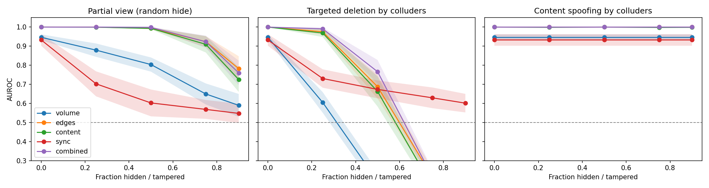
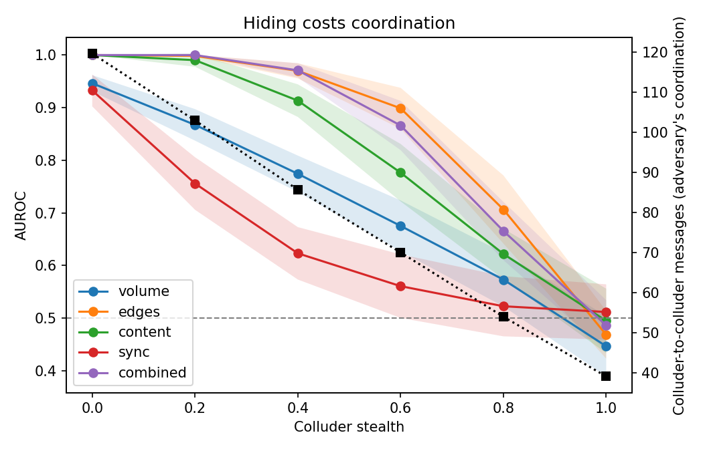
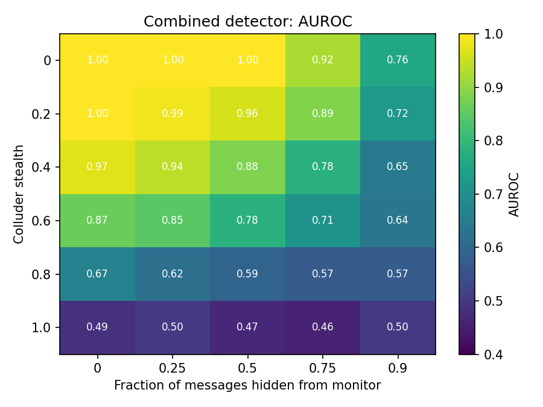
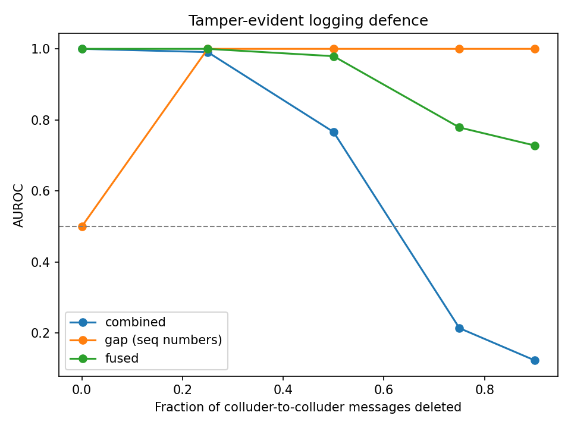
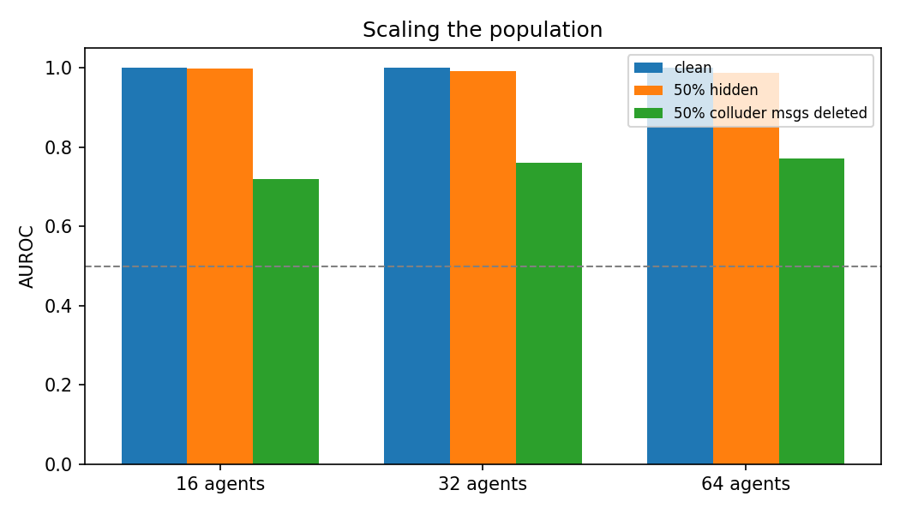
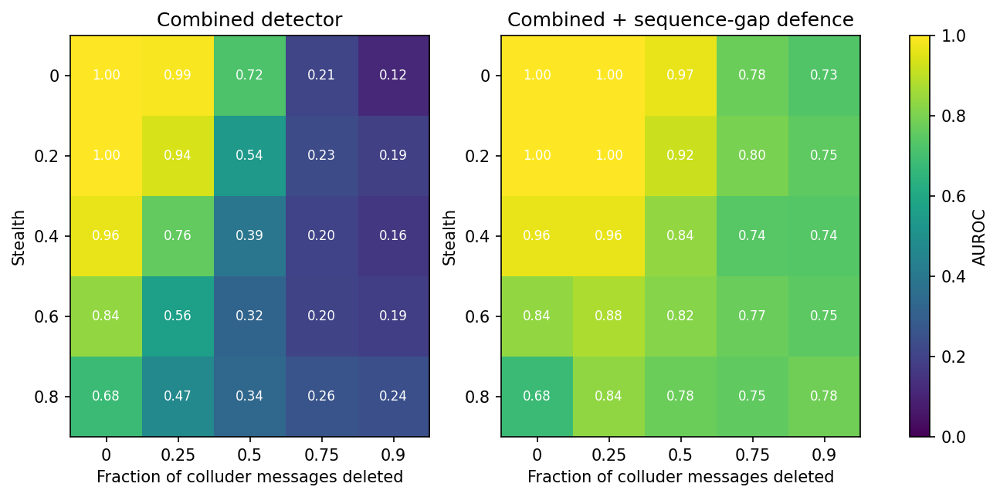
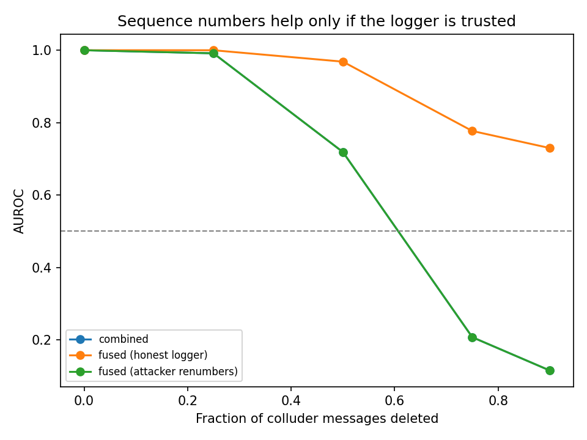
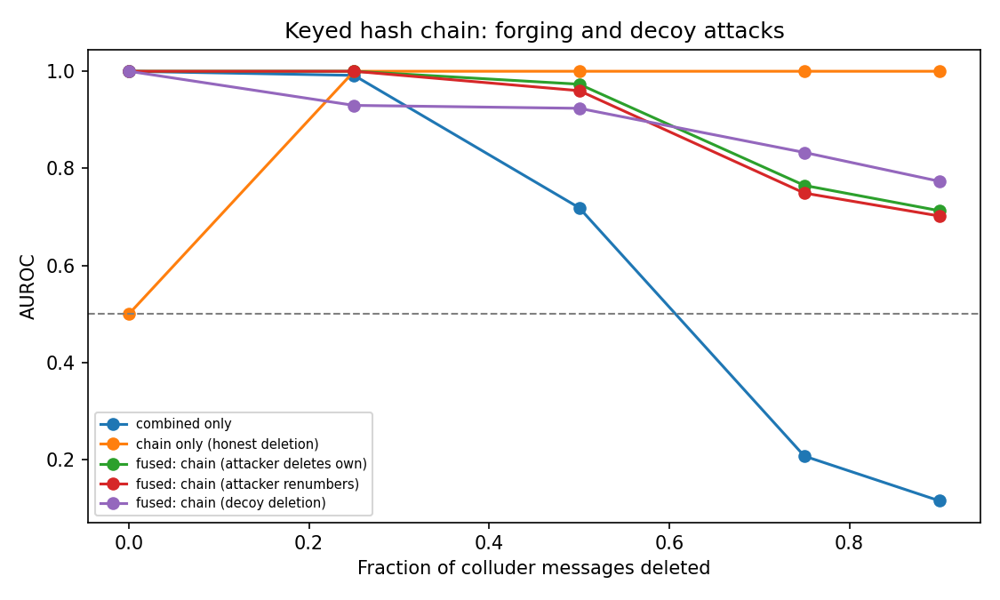
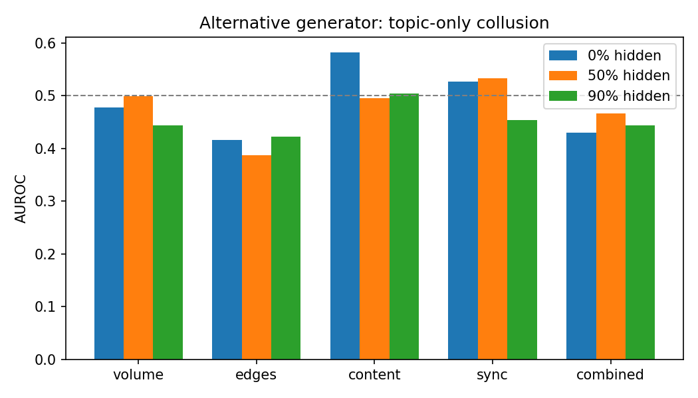

# Swarm Collusion Detector

**Track 4 (Multi-Agent Oversight and Control), Swarm Alignment Hackathon 2026**

Can a monitor detect colluding agents when it sees only part of the logs, when
colluders delete, spoof or forge their own log entries, or when they try to
look honest? We build detectors, attack them, defend them, and attack the
defences.

## Threat model
- 16 agents (also 32 and 64), about 30% hidden colluders, 60 rounds.
- Colluders message each other more, share code words, and act in bursts.
- The monitor sees message logs only and does not know who the colluders are.
- Adversary capabilities: partial observation, deleting own coordination
  messages, deleting honest messages as decoys, overwriting text, trading
  coordination for stealth, forging sequence numbers.

## Method
- `src/generate_logs.py`: synthetic logs with a `stealth` parameter.
- `src/detector.py`: per-agent scores from `volume` (naive baseline), `edges`,
  `content` (TF-IDF), `sync` (activity timing) and `combined`.
- `src/stress_test.py`: AUROC with 95% CIs over 30 seeds (figs 1-3).
- `src/gap_defence.py`: sequence-number defence against deletion (fig 4).
- `src/extensions.py`: scale test, worst-case search, forged sequence numbers
  (figs 5-7; 15 seeds).
- `src/extensions2.py`: keyed hash-chain defence, decoy deletion, and an
  alternative generator (figs 8-9; 15 seeds).

## Run
    pip install -r requirements.txt
    python src/stress_test.py
    python src/gap_defence.py
    python src/extensions.py
    python src/extensions2.py

## Key findings
1. **Fusing signals beats the baseline under partial observation.** With 50%
   of messages hidden, combined AUROC is 1.00 vs 0.80 for message volume; at
   90% hidden it is 0.76 vs 0.59.
2. **Adversarial deletion inverts the monitor.** If colluders delete their own
   coordination messages, combined AUROC falls to 0.12 at 90% deletion (below
   chance), because colluders then look quieter than honest agents.
3. **Hiding has a cost.** At stealth 1.0 every detector falls to chance
   (AUROC 0.45-0.51), but colluders also stop coordinating.
4. **Scale:** clean AUROC is 1.00 at 16, 32 and 64 agents; with 50% of
   messages hidden it is 0.99-1.00; with 50% deletion it is 0.72-0.77.
5. **Unkeyed sequence numbers detect deletion but can be forged.** Fused AUROC
   at 90% deletion rises from 0.12 to 0.73, but if the attacker renumbers its
   own messages it returns to 0.12.
6. **A keyed hash chain written by a trusted logger survives forging.** With
   renumbering attacks, fused AUROC at 90% deletion is 0.70 (vs 0.12 without
   the chain). With decoy deletion of honest messages it is 0.77. Fusion by
   summing z-scores is lossy: the chain signal alone scores higher in the
   simple deletion case (1.00), so gating on integrity is a next step.
7. **Content spoofing barely hurts** (1.00 at 90%), mostly because our
   spoofing adversary is weak.
8. **Negative result:** on an alternative generator where collusion exists only
   as shared topic vocabulary, all detectors are near chance (0.42-0.58). Our
   detector depends on graph and code-word structure.

## Limitations
- Synthetic data only; no real swarm transcripts yet (AI Village and Swarm
  Traces replay is the next step).
- Colluders follow fixed strategies and do not learn against the detector.
- The hash chain assumes a trusted logger holding a secret key, and cannot
  detect truncation of the final messages without signed checkpoints.
- Worst-case search covers a coarse grid (stealth up to 0.8, deletion up to
  90%), not a proven bound.
- Only one decoy-deletion strategy was tested.
