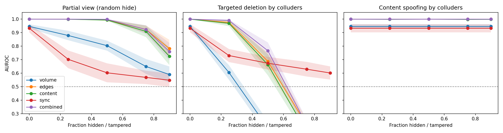
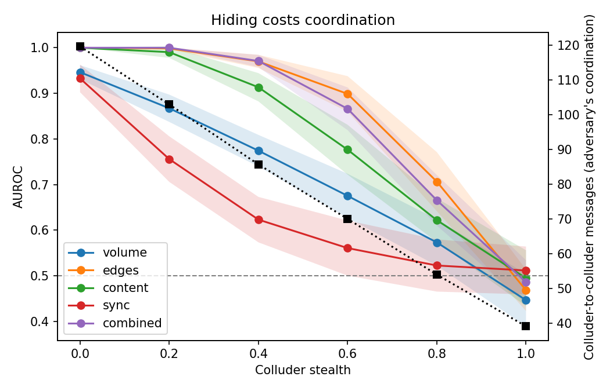
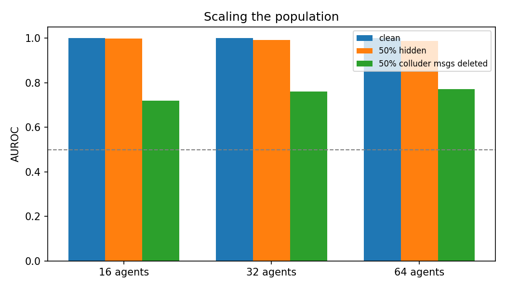
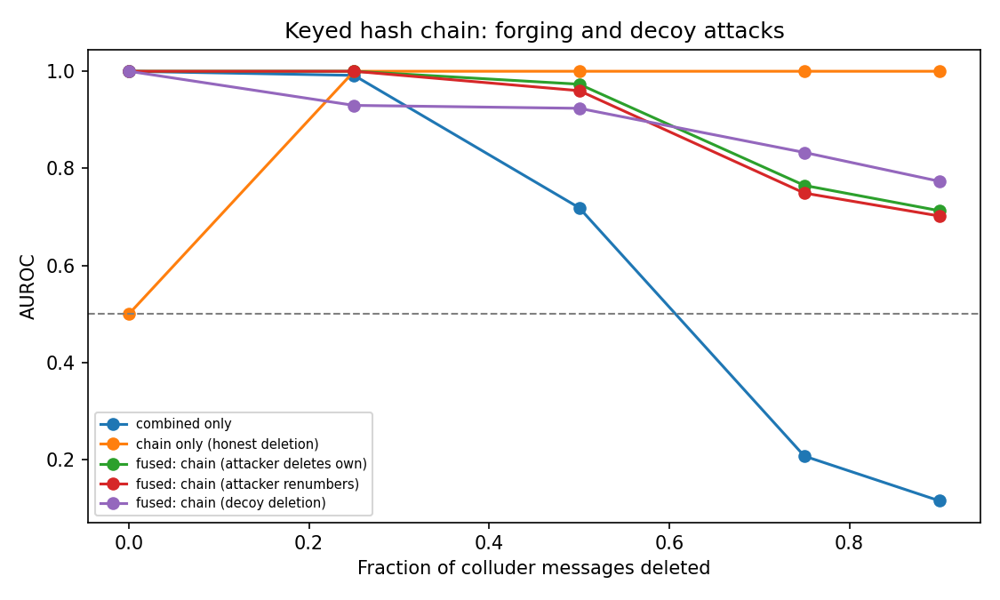
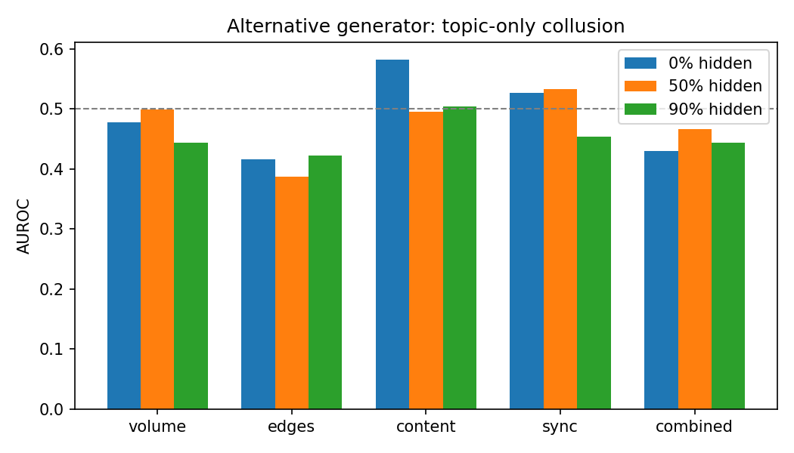

# Can a Monitor Oversee a Swarm That Edits Its Own Logs? Detecting Collusion Under Partial and Tampered Logs

**Track 4: Multi-Agent Oversight and Control | Swarm Alignment Hackathon 2026**
**Anil Dudi** | Code: https://github.com/ANIL-Dudi/swarm-collusion-detector

## Abstract

Oversight of multi-agent systems depends on logs, but agents can edit or delete the logs a monitor relies on. We build a collusion detector for agent message logs that fuses three signals (communication graph, shared content, activity timing) and stress-test it in simulation (16 agents, 5 hidden colluders, 60 rounds). The fused detector reaches AUROC 1.00 with half the messages hidden, versus 0.80 for a message-volume baseline. But an adversary that deletes its own coordination messages **inverts** the monitor: AUROC falls to 0.12 at 90% deletion, because colluders then look quieter than honest agents. Unkeyed sequence numbers recover detection (0.73) but are defeated if the attacker renumbers its messages (back to 0.12). A keyed hash chain written by a trusted logger survives renumbering (0.70) and one decoy-deletion strategy (0.77). On an alternative generator where collusion exists only as shared topic vocabulary, all detectors are near chance, which shows our detector depends on graph and code-word structure. All results are synthetic; replay on real swarm transcripts is the next step.

## 1. Motivation

The July 2026 Hugging Face incident involved about 1,200 agents coordinating through an unsanctioned message board, and METR reports that agents researched spoofing or deleting their own transcripts. Oversight built for single agents does not cover this: a population can collude, and it may be able to edit the evidence. This project asks two questions from Track 4: can a monitor that sees only part of the messages detect collusion, and can oversight still work when agents can edit or delete the logs it uses?

## 2. Threat model

- **Population:** 16 agents (also tested at 32 and 64), about 30% hidden colluders, 60 rounds of messaging, 8-word messages.
- **Colluders** message each other more, share code words, and act in synchronized bursts.
- **Monitor:** sees message logs only (sender, receiver, round, text) and does not know who the colluders are. It outputs a per-agent coordination score; we report AUROC for ranking colluders above honest agents.
- **Adversary capabilities tested:** (a) monitor sees only a random fraction of messages; (b) colluders delete their own coordination messages; (c) colluders delete honest agents' messages as decoys; (d) colluders overwrite message text; (e) colluders trade coordination for stealth; (f) colluders forge sequence numbers.

## 3. Method

**Detectors** (`src/detector.py`). Each agent pair gets three scores: message count (edges), TF-IDF cosine similarity of the agents' message text (content), and correlation of per-round activity (sync). Each is z-scored, and an agent's score is the mean of its top three pair scores. `combined` sums the three z-scores. `volume`, the number of messages an agent sent, is the naive baseline.

**Adversaries** (`src/stress_test.py`, `src/extensions*.py`). A `stealth` parameter in [0, 1] makes colluders message each other less, spread code words over a larger pool, and drop synchronized bursts, so hiding costs real coordination. Deletion, decoy deletion and spoofing operate on the logs after generation.

**Defences.** (1) *Sequence numbers:* each sender's messages are numbered, and gaps reveal deletions. (2) *Keyed hash chain:* each message carries an HMAC tag over its content and the previous tag, written by a trusted logger holding a secret key; broken chains and invalid tags are flagged. In both cases the integrity signal is fused with the combined score by summing z-scores.

**Evaluation.** AUROC with 95% confidence intervals over 30 seeds (figures 1 to 4) and 15 seeds (figures 5 to 9).

## 4. Results

### 4.1 Fusing signals beats the baseline under partial observation

| Hidden fraction | volume | edges | content | sync | combined |
|---|---|---|---|---|---|
| 0 | 0.95 | 1.00 | 1.00 | 0.93 | 1.00 |
| 0.5 | 0.80 | 0.99 | 0.99 | 0.60 | 1.00 |
| 0.9 | 0.59 | 0.78 | 0.72 | 0.55 | 0.76 |

*Mean AUROC, 30 seeds. Under random hiding, the combined detector matches the best single signal.* At 90% hidden, combined (0.76) is close to the best single signal (edges, 0.78), so fusion helps most at moderate loss.

### 4.2 Deleting its own messages inverts the monitor

If colluders delete their own coordination messages, detection collapses: combined AUROC is 0.77 at 50% deletion and **0.12 at 90%**, below chance. The volume baseline reaches 0.00 at 90% and edges 0.16. The signals we rely on, such as who talks to whom and how much, are exactly what deletion removes, so colluders end up looking quieter than honest agents. The failure is not just blindness; the ranking flips. Content spoofing barely hurts (combined stays at 1.00 at 90%), but this mostly shows our spoofing adversary is weak: the graph signal is untouched.

### 4.3 Hiding costs coordination

As stealth rises from 0 to 1, combined AUROC goes 1.00, 1.00, 0.97, 0.87, 0.67, 0.49. At full stealth every detector is at chance, but colluders have also stopped coordinating, so the adversary pays for evasion.

### 4.4 Scale

Clean AUROC is 1.00 at 16, 32 and 64 agents. With 50% of messages hidden it is 1.00, 0.99 and 0.99; with 50% of colluder messages deleted it is 0.72, 0.76 and 0.77. We saw no collapse with population size, within this simulation.

### 4.5 Defences and attacks on them

| Deleted fraction | 0 | 0.25 | 0.5 | 0.75 | 0.9 |
|---|---|---|---|---|---|
| combined only | 1.00 | 0.99 | 0.72 | 0.21 | 0.12 |
| fused, unkeyed sequence numbers | 1.00 | 1.00 | 0.98 | 0.78 | 0.73 |
| fused, unkeyed, attacker renumbers | 1.00 | 0.99 | 0.72 | 0.21 | 0.12 |
| fused, keyed chain, attacker deletes own | 1.00 | 1.00 | 0.97 | 0.76 | 0.71 |
| fused, keyed chain, attacker renumbers | 1.00 | 1.00 | 0.96 | 0.75 | 0.70 |
| fused, keyed chain, decoy deletion | 1.00 | 0.93 | 0.92 | 0.83 | 0.77 |

*Mean AUROC (15 to 30 seeds; the unkeyed fused row is from the 30-seed run).* Unkeyed sequence numbers restore detection to 0.73 at 90% deletion, but an attacker who renumbers its own messages erases the gaps and returns the monitor to 0.12. The keyed hash chain survives renumbering (0.70), because forged messages fail the HMAC check. In the one decoy strategy we tested, where colluders also delete honest messages to equalize per-agent deletion counts, fused AUROC held at 0.77. A chain-only integrity score reaches 1.00 in the plain deletion case, higher than the fused score, so summing z-scores loses information: the inverted combined score contaminates the sum. We did not test a gated combination.

### 4.6 Negative result: dependence on the generator

On an alternative generator where colluders message uniformly at random and collude only through shared topic vocabulary, every detector is near chance: content 0.58, edges 0.42, volume 0.48, sync 0.53, combined 0.43 (clean logs). The detector works when collusion shows up in the message graph or in rare shared tokens, and fails here. A likely cause is that each agent's document mixes sent and received messages, which spreads topic words to honest agents, but we did not test this. We report the result because a detector tuned to its own simulator is a real risk.

## 5. Discussion and relevance to AI safety

Three points transfer beyond this simulation. First, monitors that score "more communication means more suspicious" are inverted by an adversary that can delete its own logs; evidence integrity has to be part of the oversight design, not an assumption. Second, integrity mechanisms need a trusted logger: unkeyed counters are forgeable by the party being monitored, and the keyed chain moves trust to whoever holds the key. Third, evasion has a price: in our setting colluders who hide well also coordinate less, so oversight can rely on measuring what stealth forces the adversary to give up. For deployers and auditors, the practical recommendation is to log agent messages through infrastructure the agents cannot write to, with authenticated, chained entries.

## 6. Limitations

- Synthetic data only. We did not run on AI Village transcripts or Swarm Traces payloads.
- Colluders follow fixed strategies and do not adapt to the detector; the worst-case search covers a coarse grid (stealth up to 0.8, deletion up to 90%), not a proven bound.
- Only one decoy-deletion strategy was tested.
- The hash chain assumes a trusted logger holding a secret key, and as built it cannot detect truncation of the final messages without signed checkpoints.
- Fusion by summing z-scores is lossy (4.5); a gated combination is untested.
- The alternative generator (4.6) shows the detector does not generalize to topic-only collusion.

## 7. Future work

Replay the detector on real multi-agent transcripts; replace the colluder strategy with a learning adversary; gate fusion on integrity signals; add signed checkpoints against truncation; build a content signal robust to topic-only collusion.

## Reproducibility

    pip install -r requirements.txt
    python src/stress_test.py
    python src/gap_defence.py
    python src/extensions.py
    python src/extensions2.py

All figures and `results/results.csv` are regenerated by these scripts. Seeds are fixed.
